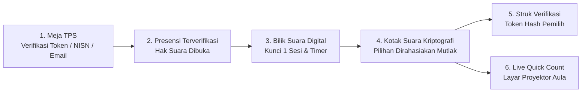

<p align="center">
  <svg width="84" height="84" viewBox="0 0 24 24" fill="none" stroke="#1E3A8A" stroke-width="2" stroke-linecap="round" stroke-linejoin="round" style="margin-bottom: 10px;">
    <path d="M12 2L2 7l10 5 10-5-10-5zM2 17l10 5 10-5M2 12l10 5 10-5"/>
  </svg>
</p>

<h1 align="center">SatuSuara — Modern E-Voting & TPS Presensi System</h1>

<p align="center">
  <strong>Platform Pemilihan Suara Digital Modern, Transparan, Kriptografis, dan Berasas LUBER JURDIL.</strong><br>
  Dirancang khusus untuk Pemilihan OSIS/MPK Sekolah, BEM Universitas, Musyawarah Organisasi, dan Pemilihan Umum Komunitas.
</p>


<p align="center">
  <a href="https://php.net"></a>
  <a href="https://laravel.com"></a>
  <a href="https://reverb.laravel.com"></a>
  <a href="https://opensource.org/licenses/MIT"></a>
  <a href="#"></a>
  <a href="#"></a>
</p>

---

## 🌟 Mengapa SatuSuara?

SatuSuara dibangun untuk mengatasi kelemahan sistem pemungutan suara konvensional berbasis kertas (rawan manipulasi, biaya cetak tinggi, dan penghitungan lambat) maupun platform pemungutan suara daring sederhana yang rentan akun ganda dan kebocoran data pilihan.

SatuSuara mengadopsi prinsip **End-to-End Voter Integrity**, perlindungan sesi perangkat (*Single-Session Locking*), kerahasiaan suara mutlak (100% Rahasia Asas LUBER), serta pembuktian tanda terima kriptografis (*Cryptographic Receipt Verification*).



---

## ✨ Fitur Unggulan

### 🗳️ Bilik Suara Pemilih (*Digital Voting Booth*)
- **Perlindungan Sesi Tunggal (*Single-Session Locking*):** Akun pemilih otomatis dikunci hanya untuk 1 sesi perangkat aktif. Jika akun sedang dibuka di Bilik 1 atau smartphone pemilih, akun tidak dapat dibuka bersamaan di komputer lain hingga proses selesai.
- **Kerahasiaan Suara 100% (Asas LUBER):** Calon atau opsi yang dicoblos tidak pernah dimunculkan pada tanda terima layar pemilih maupun tabel audit admin untuk mencegah intimidasi dan memastikan kerahasiaan mutlak.
- **Kartu Paslon Interaktif:** Tampilan profil calon ketua & wakil, nomor urut, visi utama, misi program kerja lengkap, dan foto beresolusi tinggi.
- **Dukungan Calon Tunggal (Kotak Kosong):** Tersedia opsi demokrasi penuh berhadapan dengan Kotak Kosong jika hanya ada satu paslon terdaftar.
- **Hitung Mundur Sesi & Mode Kiosk:** Sesi bilik suara dapat dibatasi waktu (1–60 menit) dengan opsi otomatis *standby countdown* untuk bilik suara umum di TPS.

### 📜 Verifikasi Kriptografi Struk Suara (*Receipt Verification*)
- **Bukti Audit Mandiri Tanpa Bocor Pilihan:** Setiap pemilih memperoleh kode hash unik (*Receipt Hash*, e.g. `VOTE-XXXX-XXXX-XXXX`) setelah memberikan suara.
- **Verifikasi Publik Transparan:** Siapa pun dapat memeriksa keabsahan suara melalui rute publik `/verifikasi-struk` untuk membuktikan bahwa suara tercatat di dalam kotak suara resmi tanpa pernah mengungkap identitas paslon yang dipilih.

### 📋 Presensi Meja TPS Fleksibel (*TPS Attendance Desk*)
- **Pencarian Cepat & Ringkas:** Petugas TPS dapat mencari pemilih dengan mengetik token DPT, NISN/NIM, nama, atau email.
- **Entri Kilat (Tombol Enter):** Cukup ketik token dan tekan *Enter* untuk menandai kehadiran pemilih secara instan.
- **Desain Khusus Tablet & Smartphone:** Tampilan mobile-first yang ramah sentuhan untuk petugas di lapangan.

### 📊 Quick Count & Mode Proyektor Aula (*Projector Fullscreen*)
- **Real-Time WebSocket Broadcasting:** Ditenagai oleh **Laravel Reverb**, hasil perolehan suara diperbarui secara langsung ke layar tanpa perlu reload peramban.
- **Fullscreen High-Visibility Mode:** Mode tampilan proyektor aula atau auditorium berlatar terang dengan kontras tajam.
- **Ekspor Dokumen Berita Acara (PDF):** Cetak rekapitulasi resmi standar A4 lengkap dengan kop instansi, rekap perolehan suara, dan lembar pengesahan saksi/panitia.

### 🛡️ Keamanan & Tata Kelola (*RBAC & Audit Trail*)
- **Hak Akses Berbasis Peran (*Granular RBAC*):** Manajemen izin terperinci (`admin`, `petugas_presensi`, `voters`, dan peran kustom) menggunakan Spatie Permission.
- **Log Jejak Audit Imutabel (*Audit Trail*):** Setiap perubahan jadwal, paslon, DPT, dan perolehan suara tercatat permanen bersama stempel waktu, alamat IP, dan User Agent.
- **Anti-Slop & Zero-Bloat Frontend:** Antarmuka responsif murni Blade + Vanilla JS tanpa kebergantungan kompleks pada framework frontend yang berat.

---

## 🏗️ Arsitektur Teknologi

| Komponen | Teknologi | Deskripsi |
| :--- | :--- | :--- |
| **Backend Framework** | [Laravel](https://laravel.com) | Framework PHP modern dengan performa tinggi & modular |
| **Bahasa Pemrograman** | [PHP 8.3+ / 8.4+](https://php.net) | Tipe data ketat (*strict types*), Enums, dan eksekusi cepat |
| **Database** | MySQL 8.0+ / MariaDB | Relasi data berintegritas tinggi dengan transaksi ACID |
| **Realtime Engine** | [Laravel Reverb](https://reverb.laravel.com) | Server WebSocket terintegrasi berkecepatan tinggi untuk siaran data instan |
| **Manajemen Peran** | [Spatie Permission](https://spatie.be) | Role-Based Access Control (RBAC) granular |
| **Jejak Audit** | [Spatie Activitylog](https://spatie.be) | Pencatatan mutlak aktivitas panitia (*Immutable Audit Logs*) |
| **Generasi Berita Acara**| [Dompdf](https://github.com/barryvdh/laravel-dompdf) | Penyusunan laporan resmi standar A4 siap cetak |
| **Impor & Ekspor Data** | [Laravel Excel](https://maatwebsite.nl) | Impor masal ribuan data pemilih DPT dari berkas Excel / CSV |
| **Desain Antarmuka** | Blade & Jost Typography | UI responsif ramah aksesibilitas (*WCAG AA*), bebas bloatware |

---

## 🚀 Panduan Instalasi Cepat

### 📋 Prasyarat Sistem
- **PHP** ≥ 8.3 (dengan ekstensi `pdo_mysql`, `mbstring`, `openssl`, `xml`, `gd`, `zip`, `fileinfo`)
- **Composer** ≥ 2.5
- **Basis Data** MySQL ≥ 8.0 atau MariaDB ≥ 10.5
- **100% PHP Murni — Zero Node.js / NPM Build Step!**

---

### 🪄 Metode 1: Web Setup Wizard (Otomatis & Direkomendasikan)

1. Klon repositori dan pasang paket Composer:
   ```bash
   git clone https://github.com/username/satusuara.git
   cd satusuara
   composer install
   php artisan serve
   ```
2. Buka peramban di alamat: **`http://localhost:8000`** (atau `http://localhost:8000/install`).
3. Sistem secara otomatis membuka **SatuSuara Setup Wizard**:
   - **Langkah 1 (Prasyarat):** Pemeriksaan otomatis versi PHP, ekstensi wajib, dan izin direktori (kompatibel penuh dengan Windows & Linux).
   - **Langkah 2 (Database):** Input kredensial MySQL/MariaDB dengan fitur tombol **Uji Sambungan** (*Test Connection*).
   - **Langkah 3 (Identitas & Admin):** Konfigurasi nama lembaga, agenda pemilihan, dan pembuatan akun Superadmin kustom Anda.
   - **Langkah 4 (Selesai):** Migrasi database dieksekusi secara otomatis, sistem dikunci aman, dan Anda langsung diarahkan ke halaman login!

---

### 💻 Metode 2: Instalasi Manual via Terminal / CLI

```bash
# 1. Klon repositori ini
git clone https://github.com/username/satusuara.git
cd satusuara

# 2. Pasang dependensi PHP
composer install

# 3. Gandakan berkas konfigurasi lingkungan
cp .env.example .env

# 4. Buat Application Encryption Key
php artisan key:generate

# 5. Konfigurasi kredensial database pada .env:
# DB_DATABASE=satusuara
# DB_USERNAME=root
# DB_PASSWORD=

# 6. Jalankan migrasi tabel
php artisan migrate

# 7. Jalankan seeder roles & permissions
php artisan db:seed --class=Database\\Seeders\\RoleSeeder
php artisan db:seed --class=Database\\Seeders\\PermissionSeeder

# 8. Jalankan server lokal
php artisan serve
```

---

## 🔑 Manajemen Akun & Pengguna

- **Instalasi Bersih (Production-Ready):** Melalui wizard instalasi web, akun Administrator dibuat murni sesuai nama, email, dan password yang Anda daftarkan di Langkah 3. Tidak ada akun dummy atau akun demo yang disisipkan ke dalam sistem.
- **Pengaturan Akun Bawaan (CLI Fallback):** Jika Anda menggunakan instalasi CLI dan menjalankan `php artisan db:seed`, akun admin awal berikut dibuat sebagai cadangan jika belum ada admin terdaftar:
  - **Email:** `admin@satusuara.id`
  - **Password:** `password123`
- Akun Petugas TPS dan akun Pemilih DPT didaftarkan secara mandiri oleh panitia melalui panel **Kelola Pengguna** dan fitur **Impor Excel DPT**.

---

## 📋 Struktur Direktori Utama

```text
SatuSuara/
├── app/
│   ├── Enums/                 # UserRole Enums & Helper Label Sentral
│   ├── Http/
│   │   ├── Controllers/Admin/ # Dashboard, Paslon, DPT, Presensi, Laporan, Pengaturan
│   │   ├── Controllers/Voter/ # Bilik Pemungutan Suara & Verifikasi Struk
│   │   ├── Controllers/       # InstallController (Web Setup Wizard)
│   │   └── Middleware/        # Single-Session Lock & Granular Permissions
│   └── Support/               # Installer Engine, AuditLogger, & Matriks Izin RBAC
├── config/
│   ├── election.php           # Konfigurasi Persisten Agenda Pemilihan & Logo
│   ├── reverb.php             # Konfigurasi WebSocket Server Laravel Reverb
│   └── broadcasting.php       # Konfigurasi Channel Broadcasting Suara & Antrean
├── database/
│   ├── migrations/            # Skema Database (DPT, Paslon, Suara, Log, Antrean)
│   └── seeders/               # RoleSeeder & PermissionSeeder
├── resources/
│   └── views/
│       ├── admin/             # Tampilan Panel Operasional Panitia
│       ├── auth/              # Halaman Masuk Terintegrasi (Desain Bebas Slop)
│       ├── install/           # Tampilan 4-Langkah Web Setup Wizard
│       ├── layouts/           # Master Layout Admin (Sidebar Drawer & Mobile Topbar)
│       └── voter/             # Antarmuka Bilik Suara & Verifikasi Struk
├── routes/
│   └── web.php                # Rute Aplikasi Terproteksi RBAC & Rate Limiting
└── tests/
    └── Feature/               # Skenario Uji Keamanan, Sesi Tunggal, & Login
```

---

## 🛡️ Catatan Keamanan (*Security Hardened*)

Sistem SatuSuara mengimplementasikan mitigasi keamanan komprehensif:

1. **Isolasi Pilihan Suara (SS-CONF-001):** Kerahasiaan suara terjamin mutlak. Pilihan paslon pemilih tidak pernah ditampilkan di layar setelah mencoblos maupun pada tabel audit admin.
2. **Sanitasi Logo SVG Anti-XSS & Anti-XXE (SS-CONF-002):** Pemeriksaan XML parser berbasis `DOMDocument` yang secara aktif melucuti tag `<script>`, atribut event `onload`/`onerror`, dan entitas eksternal berbahaya.
3. **Pencegahan Eskalasi Hak Akses (SS-CONF-003):** Staf non-admin dicegah menugaskan peran `admin` ke dirinya sendiri (*Vertical Privilege Escalation Defense*).
4. **Perlindungan Kueri Presensi TPS (SS-CONF-004):** Penyelarasan kueri pencarian presensi dalam *parameterized closure* untuk menangkal enumerasi token ID pemilih.
5. **Verifikasi Sandi Aksi Destruktif (SS-CONF-005):** Pembersihan masal data pemilih dan suara mewajibkan input konfirmasi kata sandi administrator.
6. **Rate Limiting Verifikasi Publik (SS-CONF-006):** Endpoint publik `/verifikasi-struk` dilindungi batas throttle `30 request/menit` guna mencegah serangan *Denial of Service* (DoS).

---

## 📄 Lisensi (*License*)

Proyek **SatuSuara** didistribusikan di bawah lisensi terbuka [MIT License](LICENSE).

<p align="center">
  Dibuat dengan dedikasi untuk mewujudkan demokrasi digital yang jujur, adil, dan transparan.<br>
  <strong>SatuSuara — Suara Anda, Integritas Kita Bersama.</strong>
</p>
